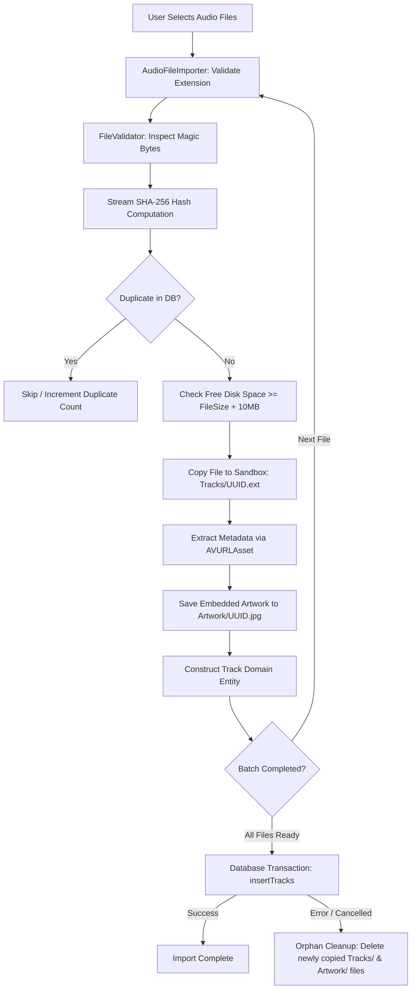

# Melora - Local Audio Ingestion & File Storage Architecture

---

## 1. Overview & Core Principles

Melora's audio ingestion architecture is engineered specifically for **user-owned, legally acquired audio files** (MP3, M4A, AAC, WAV, AIFF, FLAC). 

Key design principles:
1. **Full Sandbox Isolation:** All imported audio files are copied into the app's sandboxed `Application Support/Melora/Tracks/` directory to guarantee perpetual offline availability without risking OS cache purges.
2. **Security-Scoped URL Access:** External files accessed via the iOS Document Picker or SwiftUI `.fileImporter` are properly wrapped with `startAccessingSecurityScopedResource()` and released via `defer`.
3. **Zero Full-Memory File Buffering:** Large lossless audio files (e.g. 100 MB+ FLAC/WAV) are never read into memory all at once. SHA-256 hashing and file copying use 64 KB chunked streams.
4. **Duplicate Prevention via Content Hashing:** Files are indexed by their SHA-256 content hash. Importing an identical file again is flagged as a duplicate, preventing wasted storage.
5. **Orphan Cleanup Guarantee:** If a database transaction fails during an import session, newly copied files on disk are immediately deleted so no orphaned files remain.

---

## 2. Supported Formats & Content Integrity Validation

Melora inspects both file extensions and file header magic bytes to prevent renamed or corrupt files from entering the library:

| Format | Extension | Container | Expected Header Signature (Magic Bytes) |
| :--- | :--- | :--- | :--- |
| **FLAC** | `.flac` | Native FLAC | `0x66 0x4C 0x61 0x43` ("fLaC") |
| **MP3** | `.mp3` | MPEG-1/2 Audio | `0x49 0x44 0x33` ("ID3") or sync frame `0xFF 0xFB`, `0xFF 0xF3` |
| **M4A / ALAC** | `.m4a` | ISO MP4 | Bytes 4..7: `0x66 0x74 0x79 0x70` ("ftyp") |
| **AAC** | `.aac`, `.m4a` | ADTS or MP4 | ADTS sync `0xFF 0xF1`, `0xFF 0xF9` or "ftyp" |
| **WAV** | `.wav` | RIFF Container | Bytes 0..3: `RIFF`, Bytes 8..11: `WAVE` |
| **AIFF** | `.aiff`, `.aif` | IFF Container | Bytes 0..3: `FORM`, Bytes 8..11: `AIFF` or `AIFC` |

---

## 3. Sandboxed Storage Directory Layout

```
Application Support/
└── Melora/
    ├── Tracks/                     # Sandboxed audio files
    │   ├── 8A2F...4B1.flac         # Named by Track UUID
    │   ├── 9C3D...1E2.mp3
    │   └── A7E0...8F9.m4a
    ├── Artwork/                    # Extracted embedded album artwork
    │   ├── 8A2F...4B1.jpg          # Named by Track UUID or Album ID
    │   └── 9C3D...1E2.jpg
    └── Database/                   # SQLite database
        ├── melora.sqlite
        ├── melora.sqlite-wal
        └── melora.sqlite-shm
```

---

## 4. Security-Scoped Document Picker Integration

In iOS 18+ and SwiftUI, external files selected via `.fileImporter` require explicit permission handling:

```swift
import SwiftUI
import MeloraData

struct FileImportButton: View {
    @State private var isImporterPresented = false
    let importService: LibraryImportService

    var body: some View {
        Button("Import Music") {
            isImporterPresented = true
        }
        .fileImporter(
            isPresented: $isImporterPresented,
            allowedContentTypes: [.audio],
            allowsMultipleSelection: true
        ) { result in
            switch result {
            case .success(let urls):
                Task {
                    do {
                        let summary = try await importService.importAudioFiles(from: urls) { progress in
                            print("Importing \(progress.currentFilename): \(Int(progress.percentage * 100))%")
                        }
                        print("Imported \(summary.importedTracks.count) tracks. Duplicates: \(summary.duplicateCount)")
                    } catch {
                        print("Import failed: \(error.localizedDescription)")
                    }
                }
            case .failure(let error):
                print("Picker cancelled or failed: \(error.localizedDescription)")
            }
        }
    }
}
```

### Security-Scoped Resource Lifecycle:
```swift
let isSecurityScoped = url.startAccessingSecurityScopedResource()
defer {
    if isSecurityScoped {
        url.stopAccessingSecurityScopedResource()
    }
}
// Read file stream safely while access is granted
```

---

## 5. Metadata Extraction (AVFoundation)

Melora extracts ID3/Vorbis/MP4 tags using AVFoundation's asynchronous metadata loading:

```swift
let asset = AVURLAsset(url: sandboxedFileURL, options: [AVURLAssetPreferPreciseDurationAndTimingKey: true])

// Load duration and metadata asynchronously
let durationCMTime = try await asset.load(.duration)
let metadataItems = try await asset.load(.metadata)

// Fallbacks for missing tags
let fallbackTitle = fileURL.deletingPathExtension().lastPathComponent
let finalTitle = extractedTitle ?? fallbackTitle
let finalArtist = extractedArtist ?? "Unknown Artist"
```

If embedded artwork is present in the audio file, the image data is extracted, written atomically to `Application Support/Melora/Artwork/<UUID>.jpg`, and linked via the track's `artworkPath`.

---

## 6. Atomic Batch Import & Orphan Cleanup Pipeline



---

## 7. Library Filtering & Sorting

[`LibraryFilterService`](file:///e:/Downloads/app/MeloraData/Sources/MeloraData/Storage/LibraryFilterService.swift) provides client-side query capabilities:
- **Filtering:** By artist name, album title, or audio format (`.flac`, `.mp3`, `.wav`, etc.).
- **Sorting:** By title (A-Z, Z-A), artist (A-Z, Z-A), date added (newest/oldest), duration (shortest/longest).
- **Recently Added:** Direct SQL-indexed query on `created_at DESC`.
- **Safe Track Deletion:** Removes database row (cascading across playlists and history) and immediately deletes sandboxed audio and artwork files from disk.
