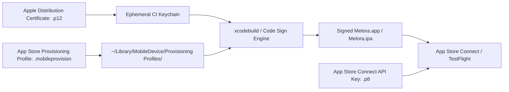

# Melora — Code Signing & Secrets Management Guide

This guide details the code signing requirements, App Store Connect API credentials, and secure secrets handling for **Melora**.

---

## 1. Code Signing Architecture

iOS applications require digital signatures from Apple to run on physical hardware or be distributed via TestFlight and the App Store.



---

## 2. Certificate & Profile Setup

### A. App Identifier
- **Bundle ID**: `com.melora.music`
- **Capabilities Required**:
  - `Background Modes`: Audio, AirPlay, and Picture in Picture (`audio`)

### B. Distribution Certificate (`.p12`)
1. In your [Apple Developer Account](https://developer.apple.com/account/resources/certificates/list), create an **Apple Distribution** certificate.
2. Download the `.cer` file and double-click to install it in **Keychain Access** on your Mac.
3. In Keychain Access, find the certificate under **My Certificates**, expand it, and select both the certificate and its private key.
4. Right-click and choose **Export 2 items...**.
5. Save as `Melora_Distribution.p12` and set a strong export passphrase.

### C. Provisioning Profile (`.mobileprovision`)
1. In the Apple Developer portal under **Profiles**, create a new **App Store** distribution profile.
2. Select App ID: `com.melora.music`.
3. Select your **Apple Distribution** certificate created above.
4. Name the profile: `Melora AppStore Distribution`.
5. Download `Melora_AppStore_Distribution.mobileprovision`.

---

## 3. Configuring GitHub Actions Secrets for CI/CD

To automate signing in GitHub Actions without committing secrets into Git, convert files to Base64 strings:

### Step 1: Base64 Encode Assets (Run locally on macOS)
```bash
# Encode Certificate .p12
base64 -i Melora_Distribution.p12 | pbcopy
# Paste into GitHub Secret: APPLE_CERTIFICATE_BASE64

# Encode Provisioning Profile
base64 -i Melora_AppStore_Distribution.mobileprovision | pbcopy
# Paste into GitHub Secret: PROVISIONING_PROFILE_BASE64
```

### Step 2: Add Secrets to GitHub Repository
Go to your repository: **Settings > Secrets and variables > Actions > New repository secret**.

| Secret Name | Description | Example / Notes |
| :--- | :--- | :--- |
| `APPLE_CERTIFICATE_BASE64` | Base64-encoded string of `Melora_Distribution.p12` | Generated via `base64 -i` |
| `APPLE_CERTIFICATE_PASSWORD` | Password used when exporting `.p12` | Strong password |
| `PROVISIONING_PROFILE_BASE64` | Base64-encoded string of `.mobileprovision` | Generated via `base64 -i` |
| `APPLE_TEAM_ID` | 10-character Apple Developer Team ID | e.g., `A1B2C3D4E5` |
| `KEYCHAIN_PASSWORD` | Ephemeral password for the CI runner's keychain | Arbitrary random string |

---

## 4. Ephemeral Keychain Automation in GitHub Actions

In CI workflows that build release IPAs, the runner dynamically creates an ephemeral keychain, imports the certificate, installs the provisioning profile, builds the archive, and immediately destroys the keychain:

```yaml
- name: Install Apple Certificate & Provisioning Profile
  env:
    BUILD_CERTIFICATE_BASE64: ${{ secrets.APPLE_CERTIFICATE_BASE64 }}
    P12_PASSWORD: ${{ secrets.APPLE_CERTIFICATE_PASSWORD }}
    BUILD_PROVISION_PROFILE_BASE64: ${{ secrets.PROVISIONING_PROFILE_BASE64 }}
    KEYCHAIN_PASSWORD: ${{ secrets.KEYCHAIN_PASSWORD }}
  run: |
    # 1. Create variables
    CERTIFICATE_PATH=$RUNNER_TEMP/build_certificate.p12
    PP_PATH=$RUNNER_TEMP/build_pp.mobileprovision
    KEYCHAIN_PATH=$RUNNER_TEMP/app-signing.keychain-db

    # 2. Decode secrets
    echo -n "$BUILD_CERTIFICATE_BASE64" | base64 --decode -o $CERTIFICATE_PATH
    echo -n "$BUILD_PROVISION_PROFILE_BASE64" | base64 --decode -o $PP_PATH

    # 3. Create temporary keychain
    security create-keychain -p "$KEYCHAIN_PASSWORD" $KEYCHAIN_PATH
    security set-keychain-settings -lut 21600 $KEYCHAIN_PATH
    security unlock-keychain -p "$KEYCHAIN_PASSWORD" $KEYCHAIN_PATH

    # 4. Import certificate into keychain
    security import $CERTIFICATE_PATH -P "$P12_PASSWORD" -A -t cert -f pkcs12 -k $KEYCHAIN_PATH
    security list-keychain -d user -s $KEYCHAIN_PATH

    # 5. Install provisioning profile
    mkdir -p ~/Library/MobileDevice/Provisioning\ Profiles
    cp $PP_PATH ~/Library/MobileDevice/Provisioning\ Profiles/
```

---

## 5. App Store Connect API Authentication

For headless TestFlight uploads without two-factor SMS prompts, use an **App Store Connect API Key**:

1. In [App Store Connect](https://appstoreconnect.apple.com), navigate to **Users and Access > Integrations > App Store Connect API**.
2. Click **Generate API Key** (Role: **App Manager** or **Admin**).
3. Record:
   - **Key ID**: e.g., `2X9R4HXF34`
   - **Issuer ID**: e.g., `57246542-96fe-1a63-e053-0824d011072a`
4. Download the private key file: `AuthKey_2X9R4HXF34.p8`.
5. Encode the `.p8` key to Base64 and add to GitHub Secrets:
   - `APP_STORE_CONNECT_KEY_ID`: `2X9R4HXF34`
   - `APP_STORE_CONNECT_ISSUER_ID`: `57246542-96fe-1a63-e053-0824d011072a`
   - `APP_STORE_CONNECT_PRIVATE_KEY_BASE64`: `base64 -i AuthKey_2X9R4HXF34.p8`

---

## 6. Security & Policy Rules

> [!CAUTION]
> **Strict Security Rules for Melora:**
> 1. **Zero Private Keys in Version Control**: Never commit `.p12`, `.cer`, `.mobileprovision`, or `.p8` files to Git. The `.gitignore` is configured to ignore all certificate and key formats.
> 2. **Never Embed Spotify Client Secret**: Melora uses OAuth 2.0 PKCE. The Client Secret is never required or present in the iOS binary.
> 3. **Revocation**: If a certificate or private key is suspected of being compromised, immediately revoke it in the Apple Developer portal and rotate GitHub Secrets.
