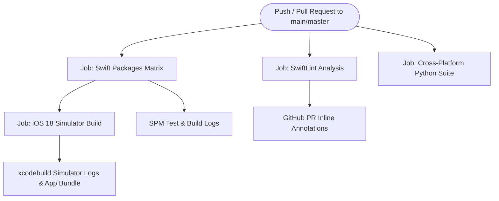

# Melora — GitHub Actions CI/CD Guide

This guide documents the automated continuous integration and continuous delivery (CI/CD) pipeline for **Melora** on GitHub Actions.

---

## 1. Overview & Pipeline Philosophy

Melora utilizes a multi-stage GitHub Actions workflow defined in [`.github/workflows/ios-ci.yml`](file:///e:/Downloads/app/.github/workflows/ios-ci.yml). The pipeline enforces Swift 6 strict concurrency, runs cross-platform unit tests, validates Swift packages in isolation, lints Swift source code, and compiles the iOS application for the iOS 18 Simulator.



---

## 2. Runner Environment & Xcode Versioning

Melora targets **iOS 18+** and requires **Swift 6.0**. To support these APIs, the workflow executes on Apple Silicon GitHub-hosted runners (`macos-15` / macOS Sequoia).

### Xcode Selection Strategy
GitHub runners contain pre-installed Xcode suites in `/Applications/`. The CI script dynamically locates and selects the highest available Xcode 16.x toolchain:

```bash
TARGET_XCODE=$(find /Applications -maxdepth 1 -name "Xcode_16*.app" -o -name "Xcode*.app" | sort -V | tail -n 1)
if [ -n "$TARGET_XCODE" ] && [ -d "$TARGET_XCODE" ]; then
  sudo xcode-select -s "$TARGET_XCODE"
fi
xcodebuild -version
swift --version
```

---

## 3. Workflow Jobs Breakdown

### Job 1: SwiftLint Static Analysis (`lint`)
- **Runner**: `macos-15`
- **Purpose**: Verifies compliance with project style guidelines, naming conventions, complexity thresholds, and formatting rules.
- **Config**: Configured via [`.swiftlint.yml`](file:///e:/Downloads/app/.swiftlint.yml).
- **Behavior**: Emits GitHub Actions warnings and errors directly into pull request review diffs (`reporter: "github-actions-logging"`).

### Job 2: Swift Packages Matrix Build & Test (`swift-packages`)
- **Runner**: `macos-15`
- **Matrix**: Evaluates each Swift package in isolation:
  - `MeloraCore`
  - `MeloraData`
  - `MeloraAudio`
  - `MeloraUI`
- **Commands**:
  ```bash
  # Build package
  swift build --package-path <PACKAGE_NAME>
  # Test package with code coverage
  swift test --package-path <PACKAGE_NAME> --enable-code-coverage
  ```
- **Artifacts**: Uploads `logs/build-<PACKAGE>.log` and `logs/test-<PACKAGE>.log` for every package target via `actions/upload-artifact@v4`.

### Job 3: iOS 18 Simulator Build (`ios-simulator-build`)
- **Runner**: `macos-15`
- **Dependency**: Runs automatically after `swift-packages` completes successfully (`needs: [swift-packages]`).
- **Project Resolution**: If `xcodegen` is available, verifies or regenerates `Melora.xcodeproj` from [`project.yml`](file:///e:/Downloads/app/project.yml); otherwise builds against the committed [`Melora.xcodeproj`](file:///e:/Downloads/app/Melora.xcodeproj/project.pbxproj).
- **Compilation Command**:
  ```bash
  xcodebuild \
    -project Melora.xcodeproj \
    -scheme MeloraApp \
    -configuration Debug \
    -destination 'generic/platform=iOS Simulator' \
    -derivedDataPath .build/DerivedData \
    CODE_SIGNING_ALLOWED=NO \
    CODE_SIGN_IDENTITY="" \
    build
  ```
- **Validation**: Verifies the resulting `Melora.app` bundle was generated in DerivedData.
- **Artifacts**: Uploads `logs/xcodebuild-simulator.log` for debugging compilation diagnostics.

### Job 4: Cross-Platform Fast Verification (`cross-platform-tests`)
- **Runner**: `ubuntu-latest`
- **Runtime**: Python 3.11+
- **Purpose**: Runs in ~0.5 seconds on Linux to validate SQLite schema migrations, Spotify RFC 7636 PKCE vectors, HTTP mock responses, security validations, and Info.plist configurations.

---

## 4. Trigger Configuration

The workflow is configured with branch protection triggers and manual execution capabilities:

```yaml
on:
  push:
    branches: [ main, master, develop ]
  pull_request:
    branches: [ main, master ]
  workflow_dispatch: # Allows manual trigger from GitHub UI
```

Concurrency groups are enabled to cancel in-progress runs when new commits are pushed to the same pull request branch:

```yaml
concurrency:
  group: ${{ github.workflow }}-${{ github.ref }}
  cancel-in-progress: true
```

---

## 5. Inspecting Build Artifacts on GitHub

When a CI run completes, you can inspect logs and test diagnostics:
1. Navigate to the **Actions** tab in your GitHub repository.
2. Select the specific workflow run.
3. Scroll to the **Artifacts** section at the bottom of the page.
4. Download the desired artifact:
   - `logs-MeloraCore`
   - `logs-MeloraData`
   - `logs-MeloraAudio`
   - `logs-MeloraUI`
   - `ios-simulator-build-logs`

---

## 6. Troubleshooting Common CI Failures

| Failure Symptom | Cause | Solution |
| :--- | :--- | :--- |
| **`xcode-select: error`** | The requested Xcode minor version is missing on the runner. | Fallback logic automatically selects available `/Applications/Xcode*.app`. Ensure `macos-14` or `macos-15` runner is specified. |
| **`Signing for "MeloraApp" requires a development team`** | Code signing is required during simulator build. | CI explicitly sets `CODE_SIGNING_ALLOWED=NO` and `CODE_SIGN_IDENTITY=""` for Simulator compilation. |
| **`Scheme MeloraApp is not currently configured for the test action`** | Shared scheme not checked into version control. | Ensure `Melora.xcodeproj/xcshareddata/xcschemes/MeloraApp.xcscheme` is committed (not ignored by `.gitignore`). |
| **`Strict Concurrency Warning treated as Error`** | Swift 6 concurrency violation across thread boundaries. | Ensure objects passed across actor boundaries conform to `Sendable` or execute within `@MainActor`. |
| **`SwiftLint violation: line_length`** | Code line exceeds 140 characters. | Break parameter lists across multiple lines or refactor expressions. |
