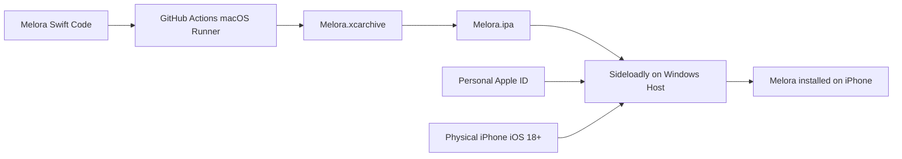

# Melora — IPA Build & Sideloading Guide

This guide describes how to produce a signed `.ipa` package for **Melora** and sideload it onto a physical iPhone using **Sideloadly** directly from Windows or macOS.

---

## 1. Overview & Sideloading Architecture

Because Melora is developed on Windows, building a signed `.ipa` package is achieved via one of two paths:
1. **GitHub Actions CI/CD (Cloud macOS Runner)**: Builds the archive and unsigned/ad-hoc `.ipa` automatically.
2. **Local macOS Machine with Xcode 16**: Directly archives and exports `Melora.ipa`.

Once `Melora.ipa` is exported, it can be signed and installed on any physical iPhone running iOS 18+ from **Windows** using **Sideloadly**.



---

## 2. Generating the IPA Package

### Method A: Via Xcode on macOS
```bash
# 1. Clean previous build directories
rm -rf build/Melora.xcarchive build/IPA

# 2. Build Release Archive
xcodebuild \
  -project Melora.xcodeproj \
  -scheme MeloraApp \
  -configuration Release \
  -destination 'generic/platform=iOS' \
  -archivePath build/Melora.xcarchive \
  CODE_SIGNING_ALLOWED=NO \
  CODE_SIGN_IDENTITY="" \
  archive

# 3. Export IPA using Ad-Hoc / Development options
xcodebuild \
  -exportArchive \
  -archivePath build/Melora.xcarchive \
  -exportPath build/IPA \
  -exportOptionsPlist Release/ExportOptions-Development.plist.template
```
The resulting `Melora.ipa` file will be located at `build/IPA/Melora.ipa`.

### Method B: Via GitHub Actions Artifacts
If you do not have a local Mac:
1. Push your changes to the `main` or `develop` branch.
2. The GitHub Actions CI workflow compiles the project and generates build artifacts.
3. Download the build artifact zip from the GitHub Actions run summary.

---

## 3. Sideloading on Windows with Sideloadly

[Sideloadly](https://sideloadly.io/) is a trusted Windows and macOS utility that signs and installs `.ipa` files onto an iPhone using a standard Apple ID (no paid developer account required).

### Prerequisites on Windows
1. **Windows 10 or 11 (64-bit)**.
2. **Apple iTunes (Non-Microsoft Store Version)**: Download the official 64-bit standalone iTunes installer from Apple:
   - [iTunes 64-bit Windows Installer](https://www.apple.com/itunes/download/win64)
3. **Apple iCloud (Non-Microsoft Store Version)**: Download the standalone iCloud for Windows installer.
4. **Sideloadly**: Download and install from [sideloadly.io](https://sideloadly.io/).

---

### Step-by-Step Installation Process

1. **Connect iPhone**:
   - Connect your iPhone to your Windows PC via USB.
   - Unlock your iPhone and tap **Trust This Computer** when prompted. Enter your passcode.
2. **Launch Sideloadly**:
   - Open Sideloadly on Windows. Verify your iPhone appears in the **Connected Device** dropdown.
3. **Load IPA**:
   - Drag and drop `Melora.ipa` into the IPA icon area in Sideloadly.
4. **Enter Apple ID**:
   - In the **Apple ID** field, enter your personal Apple ID email address.
   - *Note*: Sideloadly communicates directly with Apple's authentication servers to request a free 7-day personal development certificate.
5. **Start Signing & Installation**:
   - Click the **Start** button.
   - When prompted, enter your Apple ID password and 2-Factor Authentication (2FA) verification code displayed on your iPhone.
   - Sideloadly will automatically sign the application, transfer the binary to your iPhone, and install it.
6. **Trust Developer Certificate on iPhone**:
   - On your iPhone, go to **Settings > General > VPN & Device Management**.
   - Under **Developer App**, tap your Apple ID email.
   - Tap **Trust [Your Apple ID]** and confirm.
7. **Enable iOS 18 Developer Mode** (First-time only):
   - On your iPhone, go to **Settings > Privacy & Security**.
   - Scroll down to the bottom and tap **Developer Mode**.
   - Toggle **Developer Mode** ON, then reboot your device when prompted.
   - After restart, confirm enabling Developer Mode.
8. **Launch Melora**:
   - Tap the Melora icon on your Home screen to start using the app!

---

## 4. Apple Signing Limitations & Expiration Details

Understanding Apple's code signing policies:

| Account Type | Annual Cost | Certificate Validity | Active App Limit | Capabilities Supported |
| :--- | :--- | :--- | :--- | :--- |
| **Free Apple ID** (Personal) | \$0 | **7 Days** | Maximum **3 apps** per device | Core Audio, Files, Local SQLite, Documents |
| **Paid Apple Developer** | \$99 / year | **365 Days** (1 Year) | **Unlimited** apps via TestFlight | Background Audio, TestFlight, App Store, Custom Push |

### Renewal Process (Free Apple ID)
When using a free Apple ID, the certificate expires after 7 days. To refresh:
1. Reconnect your iPhone to Windows via USB.
2. Open Sideloadly and click **Start** with the same `Melora.ipa`.
3. The app is updated in place, preserving all your local music files, SQLite database records, and playlists!
