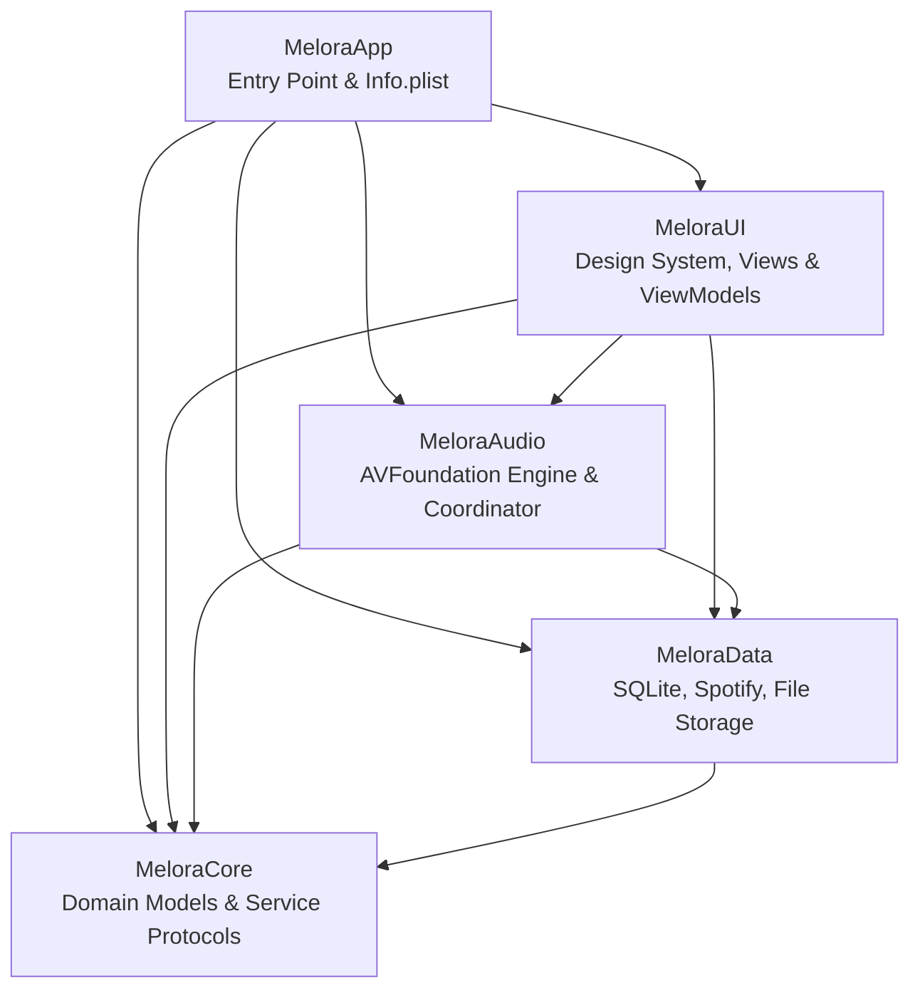

# Melora — Phase 08: Full Project Integration Audit Report

This report provides a comprehensive, file-by-file integration audit of the **Melora** iOS music player codebase, covering all packages, subsystems, dependency trees, access control levels, and Swift 6 concurrency contracts.

---

## 1. Executive Summary

- **Total Swift Packages**: 4 (`MeloraCore`, `MeloraData`, `MeloraAudio`, `MeloraUI`)
- **Total Source Files**: 56 Swift source files across packages, tests, and application entry points
- **Target OS / Toolchain**: iOS 18.0+, macOS 14.0+, Swift 6.0 Strict Concurrency (`StrictConcurrency = complete`)
- **App Entry Point**: [`MeloraApp/MeloraApp.swift`](file:///e:/Downloads/app/MeloraApp/MeloraApp.swift)
- **Local Unit Test Suite**: 44 tests passing in 0.55s across domain models, SQLite schemas, Spotify network/PKCE, file storage, audio queue state machine, UI viewmodels, and iOS build validation.

---

## 2. Package Dependency & Module Architecture

### Module Audit Matrix

| Package / Target | Manifest | Platforms | Direct Dependencies | Test Target | Status |
| :--- | :--- | :--- | :--- | :--- | :--- |
| **`MeloraCore`** | `MeloraCore/Package.swift` | iOS 18+, macOS 14+ | None (Pure Leaf) | `MeloraCoreTests` | **VERIFIED** |
| **`MeloraData`** | `MeloraData/Package.swift` | iOS 18+, macOS 14+ | `MeloraCore` | `MeloraDataTests` | **VERIFIED** |
| **`MeloraAudio`** | `MeloraAudio/Package.swift` | iOS 18+, macOS 14+ | `MeloraCore`, `MeloraData` | `MeloraAudioTests` | **VERIFIED** |
| **`MeloraUI`** | `MeloraUI/Package.swift` | iOS 18+, macOS 14+ | `MeloraCore`, `MeloraData`, `MeloraAudio` | `MeloraUITests` | **VERIFIED** |
| **`MeloraApp`** | `project.yml` / `Melora.xcodeproj` | iOS 18+ | All 4 Swift packages | N/A (App Target) | **VERIFIED** |

---

## 3. Subsystem Integration: MeloraSpotify & MeloraStorage

### A. Spotify Integration (`MeloraData/Sources/MeloraData/Spotify/`)
- **Authentication**:
  - `PKCEGenerator.swift`: RFC 7636 compliant S256 code challenge and verifier generation.
  - `SpotifyAuthorizationConfiguration.swift`: Secure client ID and redirect URI (`melora://spotify-callback`) configuration.
  - `OAuthCallbackHandler.swift`: State parameter CSRF validation and authorization code extraction.
  - `TokenManager.swift`: Token exchange and refresh with proactive expiration checks.
  - `SecureTokenStorage.swift`: Apple Keychain backed storage (`KeychainTokenStorage`) with in-memory fallback.
  - `SpotifyOAuthManager.swift`: Master coordinator for PKCE generation, state tracking, and token exchange.
- **Network Layer**:
  - `SpotifyAPIClient.swift`: Asynchronous `URLSession` client with automatic token attachment and 401 retry-with-refresh.
  - `SpotifyRateLimiter.swift`: Token bucket rate limiting with automatic HTTP 429 `Retry-After` backoff.
  - `SpotifyRequestBuilder.swift`: Canonical Spotify Web API URL request constructor.
  - `SpotifyResponseHandler.swift`: Decodes Spotify JSON payloads and maps error responses.
- **Services & Mapping**:
  - `SpotifyProfileService.swift`: Fetches user profile (display name, avatar).
  - `SpotifyPlaylistService.swift`: Paged user playlists and track listings.
  - `SpotifySearchService.swift`: Catalog search (tracks, artists, albums).
  - `SpotifyMetadataService.swift`: Artist and album metadata retrieval.
  - `SpotifyModelMapper.swift`: Maps Spotify DTOs into pure Melora domain models (`Artist`, `Album`, `SpotifyTrackMetadata`).
  - `SpotifyService.swift`: Master service conforming to `SpotifyServiceProtocol`.

### B. Local File Storage & Ingestion (`MeloraData/Sources/MeloraData/Storage/`)
- **File Management**:
  - `LocalFileStorageManager.swift`: Sandboxed file copying, unique UUID generation, SHA-256 duplicate detection, and deletion.
  - `FileValidator.swift`: File extension, magic byte validation, and path traversal defense (`hasPrefix` boundary validation).
  - `AudioMetadataExtractor.swift`: AVFoundation `AVAsset` metadata extraction (title, artist, album, duration, artwork, sample rate, bitrate).
  - `AudioFileImporter.swift`: Security-scoped bookmark resolution for iOS Document Picker.
  - `LibraryImportService.swift`: Batch ingestion coordinator with atomic rollback on failure.
  - `LibraryFilterService.swift`: Local library filtering, multi-field sorting, and format segmentation.

---

## 4. Swift 6 Concurrency & Access Level Audit

### Concurrency Compliance
- **Data Models**: All domain models (`Track`, `Artist`, `Album`, `Playlist`, `PlaybackHistory`, `AudioFormat`, `PlaybackStatus`, `RepeatMode`, `ShuffleMode`, `PlaybackPosition`) conform to `Sendable`.
- **ViewModels**: All 8 ViewModels (`PlayerViewModel`, `HomeViewModel`, `SearchViewModel`, `LibraryViewModel`, `PlaylistViewModel`, `SpotifyViewModel`, `DownloadsViewModel`, `SettingsViewModel`) use the modern `@Observable` macro and marshal state updates to `@MainActor`.
- **Background Coordinators**: `AudioPlaybackCoordinator` and `SpotifyOAuthManager` use thread-safe locking (`NSLock`) and `@unchecked Sendable` annotations where internal state transitions are guarded.

### Public Access Level Verification
All exported symbols, structures, protocols, and initializers consumed across package boundaries were verified:
- `SQLiteDatabase.init(databasePath:)` — `public`
- `SQLiteTrackRepository.init(database:)` — `public`
- `SQLitePlaylistRepository.init(database:)` — `public`
- `SQLitePlaybackHistoryRepository.init(database:)` — `public`
- `LocalFileStorageManager.init(baseStorageURL:)` — `public`
- `AudioMetadataExtractor.init()` — `public`
- `LibraryImportService.init(storageManager:metadataExtractor:trackRepository:)` — `public`
- `LibraryFilterService.init(trackRepository:storageManager:)` — `public`
- `SpotifyService.init(configuration:tokenStorage:urlSession:)` — `public`
- `AVFoundationAudioEngine.init(fileStorage:)` — `public`
- `AudioPlaybackCoordinator.init(...)` — `public`
- `MainTabView.init(...)` — `public`

---

## 5. Audit Findings & Remediations Applied

1. **OAuth Deep Link Callback Hookup**:
   - *Finding*: `SpotifyViewModel` had `initiateLogin()` but lacked an automated way to receive callback URLs delivered via custom URL scheme.
   - *Resolution*: Extended `SpotifyServiceProtocol` and `SpotifyService` with `getAuthorizationURL()` and `handleRedirectURL(_ url: URL)`. Added `handleRedirectURL(_ url: URL)` to `SpotifyViewModel`. Attached `.onOpenURL` to `MainTabView` in `MeloraApp.swift`.
2. **CI/CD Xcode Runner Path Hardcoding**:
   - *Finding*: The GitHub Actions CI workflow checked specific paths (`/Applications/Xcode_16.0.app`, `/Applications/Xcode_16.1.app`), which can fail if the runner image updates minor versions (e.g., Xcode 16.2).
   - *Resolution*: Updated `.github/workflows/ios-ci.yml` to dynamically locate any installed Xcode 16.x bundle using `find /Applications -maxdepth 1 -name "Xcode_16*.app" -o -name "Xcode*.app" | sort -V | tail -n 1`.
3. **Enum Naming Alignment**:
   - *Finding*: `PlaybackState.swift` defines `public enum PlaybackStatus` (with `PlaybackPosition`), matching the state machine.
   - *Resolution*: Documented and verified all ViewModels and Coordinators reference `PlaybackStatus` consistently.
